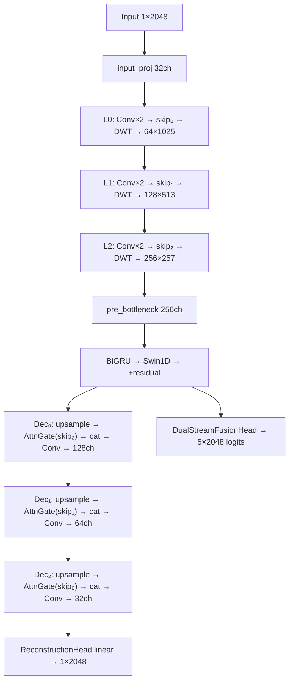

# MR-TAE-Fusion — Verified Architecture Summary

**Audit date:** 2026-05-27  
**Codebase:** `Try Model/mr_tae_fusion/`  
**Verification:** Static code read + forward pass `torch.randn(1,1,2048)` with `.venv`

---

## 1. ENCODER

| Item | Verified finding |
|------|------------------|
| **Order per level** | **Conv-first, then DWT** — `conv1 → conv2 → skip save → DWT` |
| **Not** | DWT-first pooling before conv (docstring: "Conv -> Conv -> DWT") |

### Tensor shapes (input to encoder after `input_proj`: 32×2048)

| Level | Input (C×L) | Output after DWT (C×L) | Skip (C×L) |
|-------|-------------|------------------------|------------|
| 0 | 32 × 2048 | 64 × 1025 | 32 × 2048 |
| 1 | 64 × 1025 | 128 × 513 | 64 × 1025 |
| 2 | 128 × 513 | 256 × 257 | 128 × 513 |

Lengths are ~½ input + 1 due to DWT padding/subsampling, not exact `L//2`.

### Skip connections

- **When:** After both conv blocks, **before** DWT (`skip = features` then `down = self.dwt(features)`).
- **What decoder receives:** Pre-DWT feature maps at full spatial resolution for that level.

### Wavelet

- **Type:** `db4` (Daubechies-4), hardcoded in `MRTAEFusion`.
- **Implementation:** Custom `DWT1d` — PyTorch `conv1d` + stride-2, **GPU-compatible**.
- **pywt:** Not used — **no CPU DWT latency issue**.

---

## 2. BOTTLENECK

| Item | Verified finding |
|------|------------------|
| **Topology** | **Sequential:** `pre_gru → BiGRU → gru_to_swin → Swin1D → output_proj + residual` |
| **Not** | Parallel BiGRU ‖ Swin with fusion |

### Swin 1D

| Parameter | Value |
|-----------|-------|
| Window size | 32 |
| Attention heads | 8 |
| Depth | 2 blocks |
| Embed dim | 256 |
| Shifted windows | **Yes** — `torch.roll`, alternating `shift_size = window_size // 2` on odd blocks |
| Shift mask | **Incomplete** — `_create_mask()` returns `None` (simplified 1D) |

### Normalisation

- **Before BiGRU:** No `LayerNorm` (only `Conv1d` + GRU).
- **Before Swin attention:** `LayerNorm` inside each `SwinTransformerBlock` (`norm1`, `norm2`) + final `norm` on stack.

### Fusion (bottleneck)

- Residual add only: `output_proj(swin_out) + residual(x)`.
- No concat/MLP fusion of parallel branches.

---

## 3. DECODER

| Item | Verified finding |
|------|------------------|
| **Upsampling** | Default: **linear Upsample + Conv** (`use_idwt=False`), not IDWT |
| **Skip merge** | **After upsample, before conv** — `cat([up, skip], dim=1)` then `conv1, conv2` |
| **Pre-merge gating** | `AttentionGate`: `σ(ψ(ReLU(W_g·g + W_x·x))) * x` (+ small residual on skip) |
| **Dim match** | Runtime check **passed** — upsampled `up` length matches skip at all 3 levels |

### Channel flow (deep → shallow)

```
256 → 128 → 64 → 32  (decoder blocks)
```

Skip channels (encoder order reversed): `128, 64, 32`.

### Output heads

| Head | Structure | Output activation |
|------|-----------|-------------------|
| **Signal (ReconstructionHead)** | 2× Conv1d (3×3 + 1×1), GELU on hidden only | **Linear (none)** — correct for bipolar AE |
| **Segmentation (DualStreamFusionHead)** | Global+local 1×1 conv → concat → 2× Conv3×3 → 1×1 classifier | **Logits (none)** — 5 classes |

---

## 4. WHAT TO FIX IN THE DIAGRAM

Use this checklist against a hand-drawn block diagram:

1. **Encoder block order** — Draw **two conv blocks, then DWT downsample**, not DWT then conv.
2. **Skip tap point** — Arrow from **after conv, before DWT**, not from DWT output or raw input.
3. **Skip resolution** — Skips are **full length** at each level (2048 / 1025 / 513), not half-length DWT tensors.
4. **Channel doubling at DWT** — After each DWT, channels **double** (32→64, 64→128, 128→256).
5. **Bottleneck** — Draw **BiGRU → Swin** in series, not two parallel branches merging.
6. **LayerNorm** — Show **LN inside Swin blocks**, not before BiGRU.
7. **Decoder upsampling** — Default path is **interp/upsample + conv**, not IDWT (unless diagram explicitly shows ablation IDWT).
8. **Decoder skip merge** — **Concat after upsample, before decoder convs**; attention gate sits **before** the decoder block on the skip.
9. **Wavelet label** — Use **db4**, implemented as **learnable/frozen conv filters on GPU**, not pywt.
10. **Signal head** — Final layer **linear** (no tanh/sigmoid box).
11. **Seg head** — **5-class** logits per time sample (not 4, unless config changed).
12. **Swin detail (optional)** — Note shifted windows; mention mask is simplified in code.

---

## 5. WHAT TO FIX IN TRAINING (if any)

| Issue | Severity | Recommendation |
|-------|----------|----------------|
| pywt / CPU DWT | **None** | Already GPU-native — no change needed for latency |
| Sequential vs parallel bottleneck | **Design only** | Code is sequential; if paper claims parallel BiGRU‖Swin, **fix paper/diagram**, not necessarily retrain |
| Swin shifted-window mask | **Low–medium** | Shifting runs but mask is `None`; consider implementing proper 1D SW-MSA mask for correctness |
| DWT length drift (1025 vs 1024) | **Low** | Odd lengths from padding; ensure loss/metrics tolerate; optional: tighten DWT to exact half-length |
| Decoder uses interp not IDWT | **Design** | Symmetric IDWT path exists but disabled; for “MWCNN” branding in thesis, either enable `use_idwt` or label decoder as “wavelet-inspired + skip” |
| Signal head activation | **OK** | Linear output — **no retrain needed** for activation bug |
| Seg head | **OK** | Logits without softmax in forward is standard |

**Retraining needed?** Only if you change architecture (enable IDWT, fix Swin mask, switch to parallel bottleneck). Diagram/paper corrections do **not** require retraining.

---

## Quick reference diagram (verified)



---

*Generated from ENCODER_AUDIT.txt, BOTTLENECK_AUDIT.txt, DECODER_AUDIT.txt*
